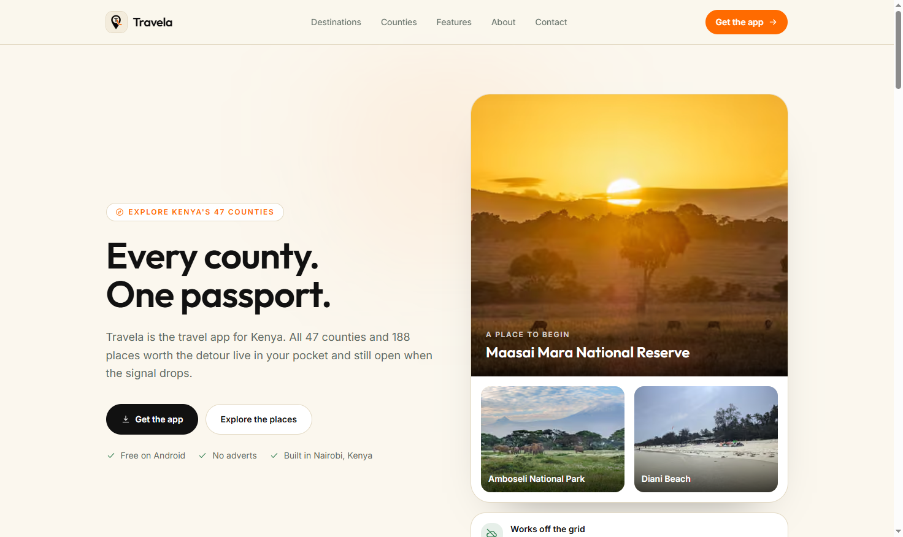

# Travela Website

The public website for Travela, a travel app for exploring Kenya's 47 counties. It introduces the app, lets visitors browse featured destinations and county guides, and provides contact and Android app request forms.

**Live website:** [https://travelaapp.vercel.app](https://travelaapp.vercel.app)



## What the site includes

- Homepage, destination explorer and destination detail pages.
- County explorer and pages for all 47 counties.
- Product, about, contact, download, privacy and terms pages.
- Contact and Android build request forms.
- Offline-conscious content: county and destination information is bundled in the site rather than fetched from a live database.
- Search metadata, sitemap, robots rules, Open Graph and X share images.
- Responsive layouts, locally bundled fonts, optimized images, security headers and Vercel Analytics.

## Technology

- Next.js 16 App Router with React 19 and TypeScript.
- Tailwind CSS 4, compiled with the Tailwind Turbopack loader.
- Cloudflare Turnstile for form challenges.
- Brevo's HTTP API for form notifications.
- Vercel for hosting and Analytics.

## Run locally

Use Node.js 20.9 or newer and npm.

```bash
npm ci
npm run dev
```

Open [http://localhost:3000](http://localhost:3000). The website's source is under `src/`; edit `src/app/page.tsx` for the homepage. The development server may also load a workspace-level `.env` from the parent directory; keep all credentials out of Git.

Useful commands:

```bash
npm run lint
npm run build
npm run start
```

`npm run start` serves the production build, so run `npm run build` first.

## Environment variables

Create a local `.env` file in this project for development. In Vercel, add the same variables under **Project Settings → Environment Variables**. Never commit `.env` files or paste secret values into source code or documentation.

| Variable | Required | Purpose |
|---|---|---|
| `BREVO_API_KEY` | Yes, for email forms | Server-only Brevo API credential. |
| `BREVO_SENDER_EMAIL` | Recommended | Verified sender address in Brevo. Defaults to the site's support address. |
| `BREVO_SENDER_NAME` | Optional | Sender display name. Defaults to `Travela`. |
| `TURNSTILE_SECRET_KEY` | Yes, for email forms | Server-only Cloudflare Turnstile secret. |
| `NEXT_PUBLIC_TURNSTILE_SITE_KEY` | Yes, for email forms | Public Turnstile site key used by the browser widget. |
| `NEXT_PUBLIC_SITE_URL` | Recommended | Canonical public origin used by metadata, sitemap and robots output. Set to `https://travelaapp.vercel.app` for the current deployment. |

The `NEXT_PUBLIC_` prefix means a value can be included in browser code. Only the Turnstile **site key** is public; never prefix secret keys with `NEXT_PUBLIC_`. Vercel supplies its own deployment environment variables automatically.

If Turnstile or Brevo is not configured, the forms cannot send messages. The rest of the site remains available.

## Deploy on Vercel

The production deployment is [travelaapp.vercel.app](https://travelaapp.vercel.app). To connect or redeploy it:

1. Import the private `TravelaApp/travela-web` GitHub repository as a Vercel project. This repository root is the Next.js project root.
2. Keep the detected Next.js framework and default build settings. The build command is `npm run build`.
3. Add the environment variables above. Set `NEXT_PUBLIC_SITE_URL` to `https://travelaapp.vercel.app`.
4. Deploy. After changing environment variables, redeploy so the new values are available to the build and server functions.
5. Configure the Turnstile widget to allow the production hostname before testing the forms.

## Turnstile hostname troubleshooting

For this deployment, add this exact hostname to the existing Turnstile widget:

```text
travelaapp.vercel.app
```

Enter the hostname only. Do not include `https://`, a path, a port, a trailing slash or a wildcard. For example, `https://travelaapp.vercel.app/` is a URL, not a valid hostname entry.

Cloudflare's Free plan permits up to 10 hostnames per widget, so three existing entries should leave room for this one. If the dashboard still rejects it:

1. Confirm you are editing the same widget whose site key is configured as `NEXT_PUBLIC_TURNSTILE_SITE_KEY`.
2. Check whether `travelaapp.vercel.app` is already listed; duplicate entries cannot be added.
3. Enter `travelaapp.vercel.app` by itself, with no spaces or URL parts.
4. If the dashboard shows an error, note its exact text and check whether another hostname was added in a different widget.
5. After it is accepted, redeploy if you changed any Vercel variables, then test the forms on the production URL.

Cloudflare allows a hostname and its subdomains when that hostname is added. Wildcards are not entered manually. Vercel preview deployments use changing hostnames, so test forms on the production domain or attach a stable preview domain and allow that hostname separately.

See Cloudflare's [Turnstile hostname management documentation](https://developers.cloudflare.com/turnstile/additional-configuration/hostname-management/) for the current format rules and limits.

## Forms and email delivery

The form endpoints are `POST /api/contact` and `POST /api/apk-request`. Both validate requests, check Turnstile tokens server-side, apply same-origin and rate-limit checks, and send notifications through Brevo to the support address configured by the site. The Brevo API key stays on the server.

If a challenge fails, first confirm that the browser hostname is allowed by the widget and that the public site key and server secret belong to that same widget. For delivery problems, check the Vercel function logs and Brevo sender configuration. Brevo's IP allow-list should remain disabled for changing serverless egress addresses.

## Project layout

```text
src/
  app/          Pages, layouts, metadata, and API routes
  components/   Shared website and form components
  data/         Bundled county, destination, and site content
  lib/          Email, security, URL, and form helpers
public/         Icons, partner assets, destination photos, and app screenshots
assets/         Source image assets, including the README homepage screenshot
```

## Useful references

- [Next.js documentation](https://nextjs.org/docs)
- [Vercel deployment documentation](https://nextjs.org/docs/app/building-your-application/deploying)
- [Cloudflare Turnstile documentation](https://developers.cloudflare.com/turnstile/)
